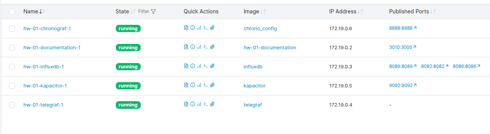
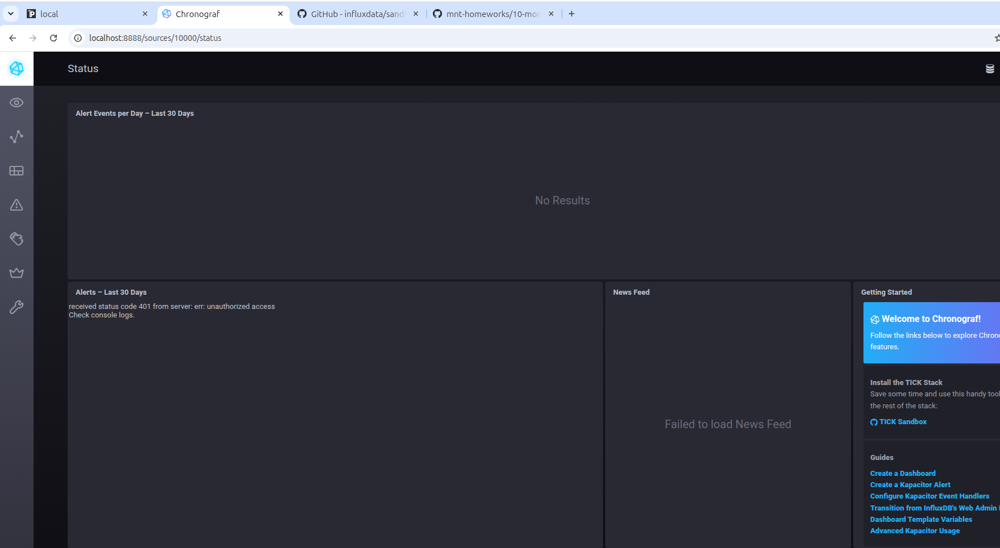
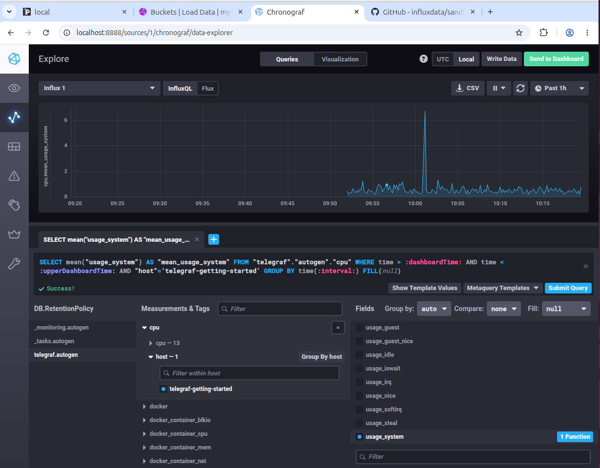
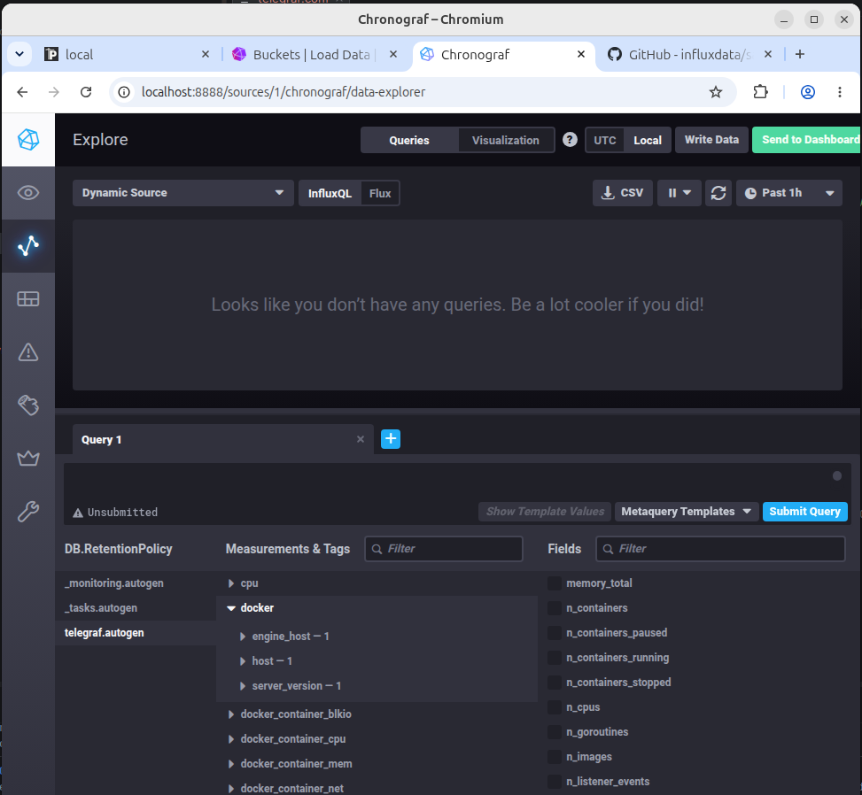

### 1 Задание:
> Вас пригласили настроить мониторинг на проект. На онбординге вам рассказали, что проект представляет из себя платформу для вычислений с выдачей текстовых отчетов, которые сохраняются на диск. Взаимодействие с платформой осуществляется по протоколу http. Также вам отметили, что вычисления загружают ЦПУ. Какой минимальный набор метрик вы выведите в мониторинг и почему?
* HTTP
    * RPS
    * Время ответа
    * Ошибки
* CPU
* Дисковые метрики
    * Свободное место
    * Время записи
*  RAM
* Метрики приложения
    * Время генерации одного отчета
    * Количество ошибок генерации отчетов

Главная задача покрыть все 4 золотых сигнала и те ресурсы на которые будет основная загрузка. 
В данном случае, основная нагрузка на CPU и Диск, в зависимости от бизнес-логики и сложности вычислений
возможно большая нагрузка на RAM.

### 2 Задание:
> Менеджер продукта посмотрев на ваши метрики сказал, что ему непонятно что такое RAM/inodes/CPUla. Также он сказал, что хочет понимать, насколько мы выполняем свои обязанности перед клиентами и какое качество обслуживания. Что вы можете ему предложить?

Создать отдельный Дашборд для менеджера:
* Доступность - Зеленый (SLO выполняется), Красный (падаем ниже 99%)
* Обработано отчетов за сегодня
* Среднее время генерации отчета (в секундах)
* Количество инцидентов за день/неделю/месяц

### 3 Задание:
> Вашей DevOps команде в этом году не выделили финансирование на построение системы сбора логов. Разработчики в свою очередь хотят видеть все ошибки, которые выдают их приложения. Какое решение вы можете предпринять в этой ситуации, чтобы разработчики получали ошибки приложения?
Можно использовать что-то легковесное:
* rustrak
* logtide

### 4 Задание:
> Вы, как опытный SRE, сделали мониторинг, куда вывели отображения выполнения SLA=99% по http кодам ответов. Вычисляете этот параметр по следующей формуле: summ_2xx_requests/summ_all_requests. Данный параметр не поднимается выше 70%, но при этом в вашей системе нет кодов ответа 5xx и 4xx. Где у вас ошибка?

В summ_all_requests попадет много мусора (metrics, helth и тд).

### 5 Задание:
> Опишите основные плюсы и минусы pull и push систем мониторинга.

#### Pull — мониторинг сам забирает данные с сервера. 
* Плюсы: сразу видно, если сервер не отвечает. 
* Минусы: не успеет забрать данные у коротких задач.

#### Push — сервер сам отправляет данные в мониторинг. 
* Плюс: подходит для коротких задач и пиков нагрузки.
* Минус: если данные не пришли — непонятно, сервер упал или просто молчит.

### 6 Задание:
> Какие из ниже перечисленных систем относятся к push модели, а какие к pull? А может есть гибридные?

* Prometheus (pull)
* TICK (push)
* Zabbix (гибрид)
* VictoriaMetrics (гибрид)
* Nagios (гибрид)

### 7 Задание:

### 8 Задание:

### 9 Задание:
